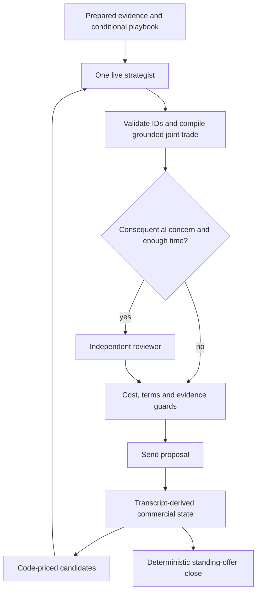

# Unified negotiation architecture

`unified` is an experimental shared agent for every case type. The existing `router` is unchanged.
Python owns prices, legal terms, evidence sentences and closing. Models interpret evidence and
choose among bounded proposals; they cannot send arbitrary prices or accept deals.

## Preparation and evidence

`negotiation/evidence.py` retains source IDs, supplier/part scope, periods, observations,
calculations and uncertainty. Index changes are recomputed from documented endpoints. Incomplete
sources remain incomplete; should-cost remains an estimate, not a supplier reservation price.
Complaint-only ppm averages are excluded because they do not establish a supplier-wide denominator.

Four parallel specialists receive targeted should-cost, recent price, invoice and negotiation
history digests alongside document excerpts. Missing tables supply no evidence. A buyer planner
and supplier advocate challenge the findings; a lead synthesizes the brief. The whole preparation
budget is 80 seconds before session opening. Active resumed sessions skip heavy preparation.

The brief contains grounded trade requests, evidence priorities, hypotheses and conditional
playbooks. Every playbook entry needs a source quotation, an allowed trigger and an invalidation
condition. Rehearsal stays hypothetical. Failed synthesis retains successful specialist findings.

## Commercial state and pacing

`negotiation/control.py` rebuilds state from the transcript, including on resume. Price changes
are comparable only when completed non-price packages match. It tracks stalls, unadopted terms
and cumulative comparable gaps. Non-adoption is not explicit rejection; cumulative gap is not
a known supplier patience threshold.

A model stance alone cannot change the opening. In leverage cases, a valid rival bid or a
calculated falling cost driver permits a competitive opening (at least 20%, capped at 25%
discount). Otherwise the configured opening applies. Relationship goals retain cost-optimum and
capacity protections. These constants are experimental policy settings, not learned floors.

One hold probe is allowed after a first comparable supplier concession closes at least as much
price distance as remains, with more than three estimated moves left. It cannot repeat and does
not apply to changed terms. Other moves use the configured concession schedule. Repeated stalls
and unadopted trades inform live decisions and conditional review.

The code-priced menu includes bounded pacing choices, competitive bids, trades and the structures
of current supplier alternatives. Candidates show term changes, non-adoption counts, cost-band
comparability and the isolated cost of index changes at an unchanged price. Rounding differences
should not decide between economically equivalent strategies. Exact cost guards still apply.

## Live reasoning



One strategist chooses candidate/claim IDs, alternatives and a short acknowledgement. It may
also interpret one joint non-price request from a live quotation. Code validates the source and
allowed values, then prices it at no higher buyer cost than the selected candidate. Invalid
requests leave the original proposal intact. Alternatives must satisfy the same numeric guards.

Review changes replace the primary and alternative IDs as one proposal, within the original
turn cost ceiling. Changing a package clears the earlier paragraph; code renders the final terms.
A reviewer needs a supported supplier constraint, an observed stall or an uncompensated concession
to change the primary. A marginal hypothetical cost advantage alone is insufficient. Logs show
the lead selection, final bundle and any intervening adjustments.

Costly term concessions are measured against our prior terms and available protection in the
same index structure. Merely introducing an index is not classified as losing deadband protection.
Compensation is observed only when a current supplier package offers an equal or better complete
cost than a valid earlier supplier quote containing the protected terms. Our own proposed discount
does not count. An unconfirmed concession is kept as a conditional alternative alongside a
code-priced protected primary. If none is feasible within the turn budget, no new proposal is sent.
An ignored alternative is not a refusal; repeated values in one message count only once per reply.

Routine turns use one call with up to 25 seconds. Additional review is considered for weaker
uncompensated terms, disputed evidence, repeated stalls or a repeatedly unadopted selected trade.
It needs at least eight seconds remaining and receives at most ten seconds. Total model time is
capped at 40 seconds and shortened by the actual reply/wave deadline. Failed review preserves a
valid lead decision; failed lead uses the deterministic fallback. Protocol lookahead and closing
make no model calls. Model requests disable Anthropic SDK retries, cap output at 4,096 tokens,
and distinguish output-limit stops from malformed JSON. Preparation/live pools are separate.

Cheaper supplier alternatives are proposed back for confirmation. Only current valid standing
offers below the alternative can be awarded. Historical quotes are never executable. No new
unconditional push after a final offer was added.

## Empirical memory

`negotiation/memory.py` imports completed local practice logs without network or model calls.
Records contain normalized price paths and package features, evidence feedback, policy labels
and outcomes. Retrieval uses case type, goal, negotiable fields and bidder counts, not supplier
or case IDs. Sample counts and uncertainty are explicit; different policy configurations are
retained where possible. Simulation and final results are excluded.

These are uncontrolled observations, not causal rules, calibrated probabilities or guaranteed
scores. Completed logged unified practice runs append local observations. Missing memory is
valid. `CSEE_EXPERIENCE_PATH` overrides `csee/negotiation/experience.jsonl`; include the snapshot
when moving to another machine if the same memory is desired. Schema versions permit reimport.

From `starter-kit/`, import existing logs offline:

```bash
uv run python -m csee.negotiation.memory --runs ../runs
```

## Evaluation modes

| Agent | Preparation | Live reasoning |
|---|---|---|
| `unified` | Full team | One strategist; selective review |
| `unified-fast` | Full team | One strategist; no reviewer |
| `unified-review` | Full team | Review every successful decision when time permits |
| `unified-single` | Legacy single research call | Legacy single-call contract |

The first three share preparation and policy to isolate review effects. `unified-single` is a
broader ablation, not a frozen old version. `--no-llm` uses the same code policy without reasoning.
Local simulation validates mechanics, not hosted supplier performance:

```bash
uv run python -m csee --no-llm --agent unified sim --variants base --cases case:P05 case:P18 --seeds 1
```

Hosted practice command (spends quota and model credits; do not execute automatically):

```bash
uv run python -m csee -v --agent unified --variant base play case:P05 --confirm
```

## Observed results and limits

The first hosted team runs scored P05 **0.487049** and P18 **0.419031**. Preparation leads failed
JSON parsing, protocol lookahead duplicated live calls, and keyword filtering removed useful
P18 indices. Those defects were corrected before the next user runs.

`20261025-000804-unified-practice` scored P05 **0.566336** with 52 successful role calls and no
failures. `20261025-000805-unified-practice` scored P18 **0.566809** with 18 successful calls,
one adviser timeout, and four successful decisions. P18 reached 5.30 at 90-day payment but
finished with a 3% rather than 5% deadband. These runs motivated this extension; they did not test it.

Validation is offline: controlled model responses, transcript reconstruction, unknown suppliers,
pricing/validation, deadline/fallback checks and hosted-case smoke tests. No hosted negotiation
or paid model evaluation was started by the coding agent. Promotion requires repeated comparisons
with the existing router; passing tests does not establish a score gain.
