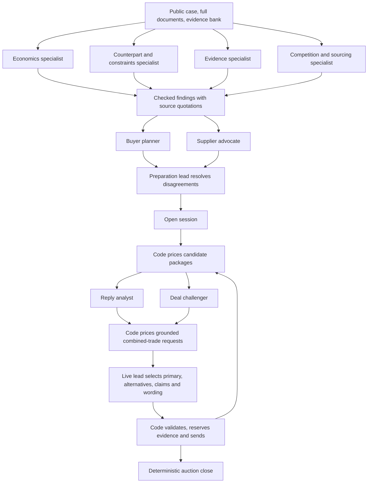

# Unified negotiation team

`--agent unified` is the candidate architecture for all seven negotiation types. It is an original
implementation inspired by Codacabana's division of responsibilities, built on our cost, evidence,
and runner utilities. It is not yet promoted to the final `router`.

## Runtime workflow



### Preparation: seven roles per supplier

Four specialists run concurrently. Economics examines cost drivers, should-cost uncertainty and
term economics. Counterpart examines authority, liquidity, capacity, hedges and contractual
constraints. Evidence checks relevance, freshness and conflicting facts. Competition examines
alternatives, sourcing history, rival quotations and dependence.

An independent buyer planner and supplier advocate then run in parallel over their checked
findings. The advocate challenges the plan and identifies possible objections; its rehearsal is
explicitly hypothetical, never evidence of the real supplier's reservation price. A preparation
lead reconciles both perspectives and produces:

- Evidence-backed opening stance: competitive, balanced, or protect supply.
- Ranked evidence kinds and identified claims to avoid.
- Grounded requests for combined non-price trades, using allowed term values only.
- Priorities, unresolved risks and hypotheses with exact source quotations.

Code translates stance into bounded opening parameters. Relationship cost bounds still apply.
Code prices trade requests; no role can invent a unit price, change a fixed term, or authorize a
deal. A failed specialist does not erase its colleagues' findings. Failed synthesis retains
independently grounded trade requests while falling back to a balanced opening.

The preparation budget is at most 80 seconds including dossier construction: research receives
up to 30 seconds, rehearsal up to 25 seconds, and the lead the remaining budget. This happens
before the session opens. The runner skips preparation when a session is already active or a
wave has insufficient time. Sources include actual document text, not just titles, with a
bounded mix of recent source families. Ordinary no-model runs skip model preparation entirely.

### Live turns: parallel advice, then a deciding lead

The reply analyst reads the latest correspondence, sheets and claim feedback; only recent
thread/attachment quotations can substantiate its observations and trade requests. Old dossiers
remain hypotheses. In parallel, a deal challenger critiques the priced menu and auction state,
looking for unnecessary concessions, better packages and unreliable assumptions.

Code can add the analyst's combined-term request to the menu without changing existing candidate
IDs. The lead receives both advisers, the refreshed menu, evidence and complete bid comparisons.
It chooses the primary candidate, zero to two alternatives, claims and a short acknowledgement.
It can disagree with either adviser. Empty alternative or claim selections are respected.

A turn has at most 40 seconds of model time, shortened by the remaining supplier reply clock and
wave cap. Advisers share at most 18 seconds; the lead uses the remainder. With less than 20 seconds
available, advisers are skipped and the lead acts directly. Late or invalid lead output returns
to the deterministic proposal. There is no extra writer call or model call needed to close.

Preparation and live work have separate process-wide concurrency pools (16 and 24 slots), so
research cannot occupy every live decision slot. Queue time consumes the same absolute deadline.
Timed-out model workers return data only and cannot mutate agent state. Anthropic requests cap
output at 2,048 tokens and disable SDK retries inside the request budget.

### Deterministic economics and execution

The engine advances concessions in estimated supplier value and searches non-price terms at
that value. It preserves a cost-equivalent supplier term instead of undoing the previous turn's
trade. Menus include pace choices, single-lever exchanges, grounded combined trades and a
code-priced option to beat a valid live rival on complete buyer cost. Supplier estimates remain
uncertain; a cost-neutral trade is not proof of supplier acceptance.

All candidates must have finite numbers, legal fields/options, preserved fixed terms and valid
must-haves. Reciprocal trades cannot exceed the baseline buyer cost. We do not retract a price
already offered for the same package or silently retract a mutually offered index structure.
Alternative sheets must have different non-price packages, not just different prices for the
same package. Code writes the exact sheets and citations, with shared evidence reservations
protected against competing supplier threads.

The coordinator accepts only a live first sheet below the buyer's alternative, valued on that
supplier's defaults. A supplier alternative requires confirmation. Final offers do not trigger
speculative extra price pushes. No team member can independently award an RFQ and close its rivals.

## Code map

| File | Responsibility |
| --- | --- |
| `csee/agents/unified.py` | State, evidence retrieval, team integration, message composition and auction close |
| `csee/negotiation/preparation.py` | Specialist/rehearsal/lead workflow and grounded output contracts |
| `csee/negotiation/council.py` | Live reply analyst, deal challenger and lead |
| `csee/negotiation/engine.py` | Value-based proposal calculation and priced candidate generation |
| `csee/negotiation/strategy.py` | Bounded model calls, parallel stages and output helpers |
| `csee/runner.py` | Session lifecycle, preparation before opening, supplier clocks and run reporting |

The existing `CseeAgent` still supplies protocol handling and quote parsing; the new team does
not route into Mert/Ege variants. Existing `Params` remain compatible for explicit experiments.
No new framework dependency is needed: the workflow is an explicit staged graph of model roles.
These roles may use the same configured model, but have separate instructions, inputs and outputs.

## Run, observe and compare

From `starter-kit/`, exercise the team against local scripted suppliers with the configured model:

```sh
uv run python -m csee -v --agent unified sim --llm \
  --variants base --cases case:P05 --seeds 1
```

This uses model API credits, not arena quota. For P05's three suppliers, preparation can make up
to 21 model calls, followed by up to three calls per active supplier turn. `-v` prints role
completion and latency. Run logs contain `unified_role`, preparation reports, adviser reports,
menus, selections and fallback reasons. The terminal also prints a case-level team-call and
validated-decision summary, so a fallback-only run cannot be mistaken for a working strategy layer.

Compare against the single-call workflow using the same updated engine and validators:

```sh
uv run python -m csee -v sim --llm --agents unified-single unified \
  --variants base --cases case:P05 --seeds 1
```

`unified-single` is an ablation, not a frozen copy of the previous commit. Its model budgets differ
from the full team, so this comparison evaluates complete configurations, not agent count alone.
For zero model/API calls, omit `--llm` and use `--no-llm` before `sim`. The local simulator is useful
for correctness and controlled comparisons, but is not a reliable predictor of hosted scores.

## Evidence so far

Before the multi-agent extension, a deterministic one-seed ten-case simulation averaged 0.348
versus the router's 0.313, with regressions on P11 and P18. The user's first model-enabled P05 run
returned 0.205830 with all 16 calls timing out. After correcting request budgets, the next run
(`runs/20261024-233327-unified-sim`) returned 0.212760: all three preparation calls and all 13 live
calls succeeded. Nine live selections merely changed lead time, three selected a patient price
step, and one selected the baseline. Live calls averaged 10.46 seconds. This exposed a narrow
menu, repeated use of old document metadata, and term concessions being undone on later turns.

The multi-agent extension is validated with controlled model responses, including real parallel
execution, stage dependencies, failed specialists, deadline fallback, grounded combined-trade
requests and unknown suppliers. No paid model run or hosted negotiation was started by the coding
agent for this extension. There is no new performance claim yet. Promote only after a paired
hosted comparison with the existing router under the normal quota rules.
